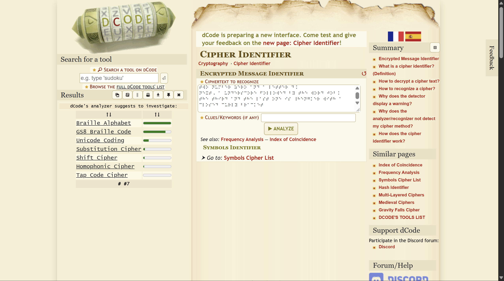
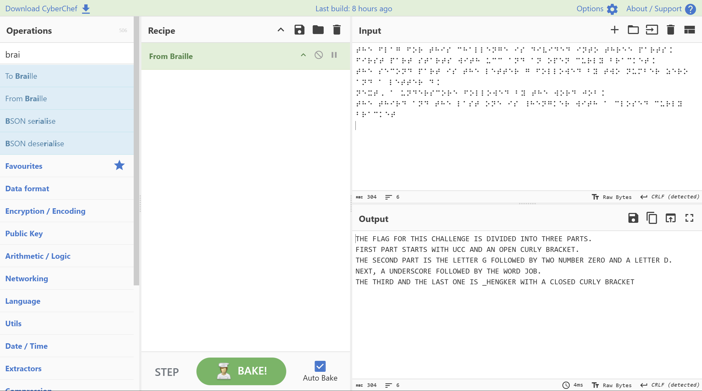

# Blind

- **Category:** Miscellaneous
- **Difficulty:** Easy

## Challenge Description

> Try this. If you can't see it, feel it.

## Analysis

### Step 1: dcode analyzer

Firstly, i opened up dcode cipher identifier and analyzed the file contents:



dcode's analyzer suggests that i should investigae Braille Alphabet to solve it.

### Step 2: Opened up Cyberchef

I pasted the phrase in cyberchef and used From Braille:



From the output text, I constructed the flag. So, the final flag is:

```text
UCC{G00D_JOB_HENGKER}
```

---
