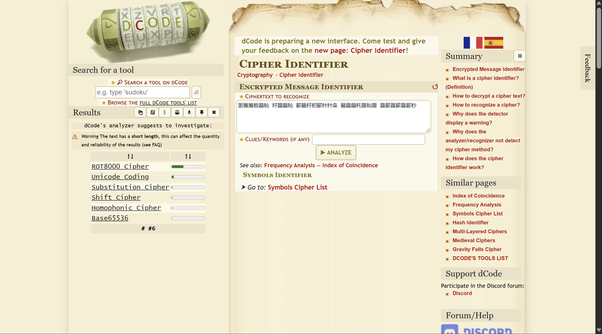
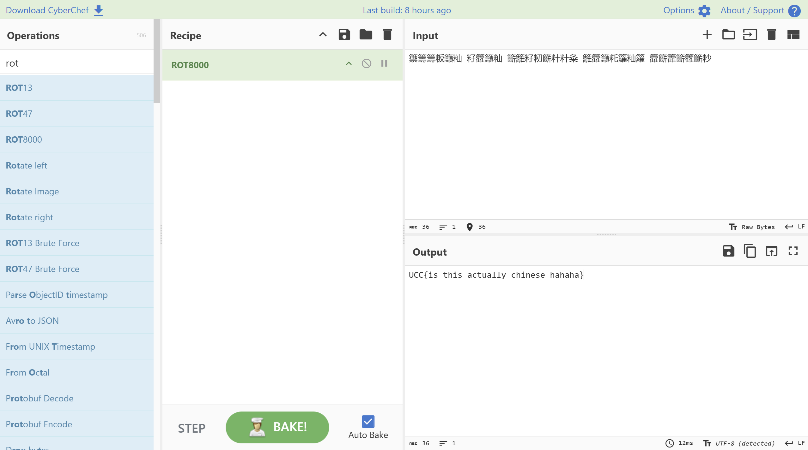

# Great Wall Of China

- **Category:** Cryptography
- **Difficulty:** Easy

## Challenge Description

> 8000 years ago was The Stone Age era. Someone told me that the message below are for the future, but i don't think chinese language exist yet at that time?!
>
> 籞籌籌粄籲籼 籽籱籲籼 籪籬籽籾籪籵籵粂 籬籱籲籷籮籼籮 籱籪籱籪籱籪粆

## Analysis

### Step 1: Figuring out the given phrase(?)

Firstly, i opened up dcode cipher identifier and analyzed the phrase:



dcode's analyzer suggests that i should investigae ROT8000 on this phrase.

### Step 2: Opened up Cyberchef

I pasted the phrase in cyberchef and baked with ROT8000. it outputs the flag:



```text
UCC{is this actually chinese hahaha}
```

---
