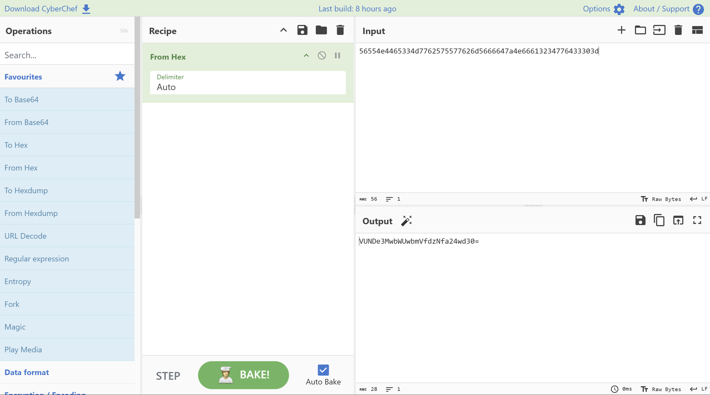
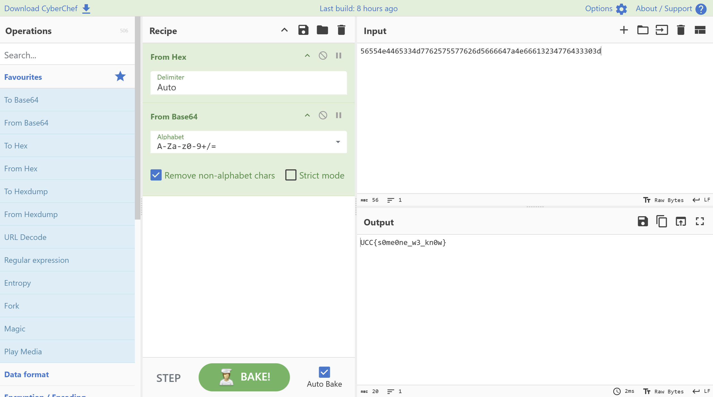

# Hacker Bawang

- **Category:** Cryptography
- **Difficulty:** Easy

## Challenge Description

> Faris and Hanif actually thought their private chat was totally secure. They were busy spilling the tea about their crushes and completely oblivious to the fact that Alice was snooping around pulling a man-in-the-middle (MitM) attack on their network. The funny thing is, the guys didn't even use a real ciphertext or a secret key, they just wrapped their texts in basic encoding formats. Alice managed to intercept their conversation but she needs a little help decoding the message. Can you help Alice uncover their juicy secret?
>
> author: @jiha

## Analysis

### Step 1: Cyberchef

From the file, the payload **"56554e4465334d7762575577626d5666647a4e66613234776433303d"** seems like its a hexadecimal phrase.

Opened up cyberchef and used **From Hex**:



The output result seems like its a Base64 phrase. So i used **From Base64** to decode the phrase:



and then there is the output! Therefore, the flag is:

```text
UCC{s0me0ne_w3_kn0w}
```

---
