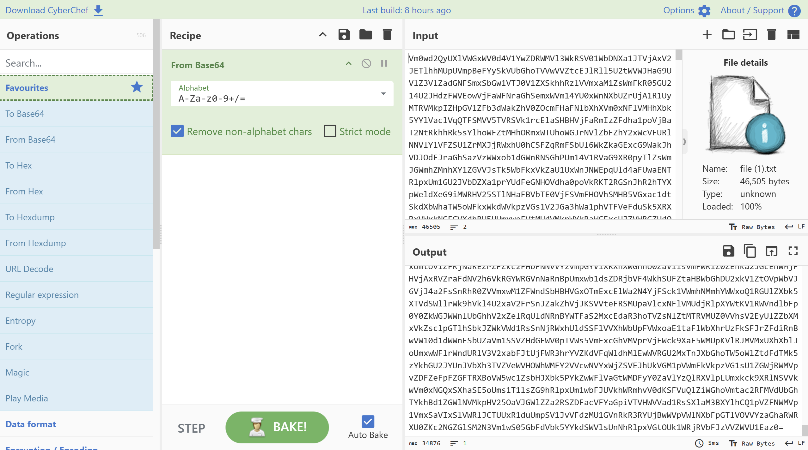
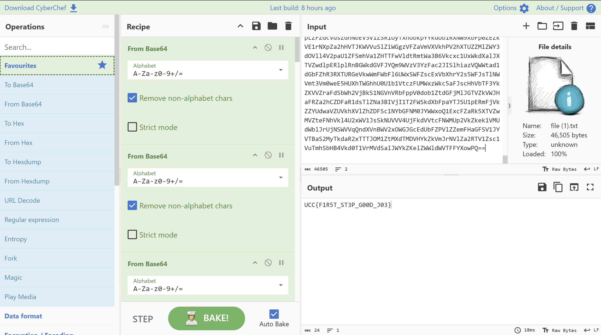

# Very Long Text

- **Category:** Cryptography
- **Difficulty:** Medium

## Challenge Description

> You receive a mysterious message from your friend, who is a programmer. Your friend has encoded an important text 26 times as a test to assess your problem-solving skills.

## Analysis

### Step 1: Analyze the file

The given file contains a very long text. Tried to input in CyberChef and used magic but it took too long for it to process.

Then i took a closer look inside the file and i noticed the long text ends with "==" which could possibly be a Base64 phrase.

### Step 2: CyberChef

I put the file into CyberChef and tried to put Base64 into the recipe:



The long phrase become abit shorter and it still ends with "=" which is also possibly a Base64 phrase. So i continued to input more Base64 into the recipe.



After putting Base64 for 26 times into the recipe, the file is finally being outputted! Therefore the flag is:

```text
UCC{F1R5T_ST3P_G00D_J03}
```

---
