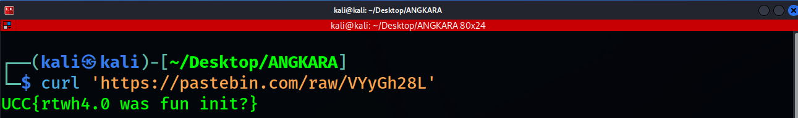

# Inspector Gadget

- **Category:** Digital Forensics
- **Difficulty:** Easy

## Challenge Description

> Reading logs is a must in digital forensic investigation. Here is a web log capturing an attempt on directory fuzzing. Can you tell what's happening?

## Analysis

### Step 1: Analyze the .log file

The given .log file is a web log capturing attempt on directory fuzzing. after going through the logs, it seems like there is a brute force attempt using gobuster.

After some analysis, i found that the attacker is brute forcing the web's directory, searching for available web directories. I found 2 different http codes:

- 404 - not found
- 200 - request successful

Most of the brute force attempts are unsuccessful (404). I tried to search for successful results by searching 200 in the logs and i found 2 lines that are interesting:

- 172.26.228.247 - - [08/Nov/2024:21:46:13 +0800] "GET /index.html HTTP/1.1" 200 3327 "-" "gobuster/3.6"
- 172.26.228.247 - - [08/Nov/2024:21:46:13 +0800] "GET /pastebin.com/VYyGh28L HTTP/1.1" 200 437 "-" "gobuster/3.6"

The **index.html** seems normal because high chance it could be just a normal landing page. The second one, pastebin.com/VYyGh28L seems to be directing to something.

### Step 2: Investigate the URL

I opened kali linux terminal and ran:

```bash
curl 'https://pastebin.com/raw/VYyGh28L'
```

and it outputs the flag:


So its clear that the flag is:

```text
UCC{rtwh4.0 was fun init?}
```

---
