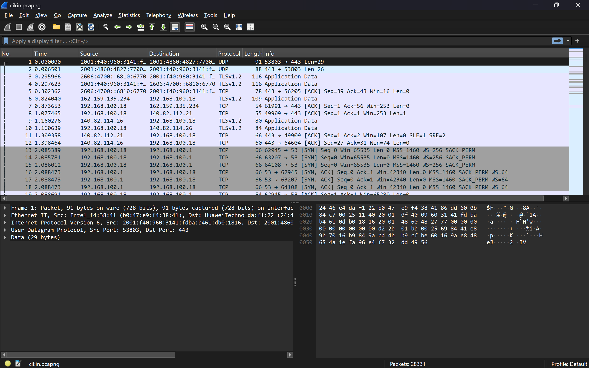
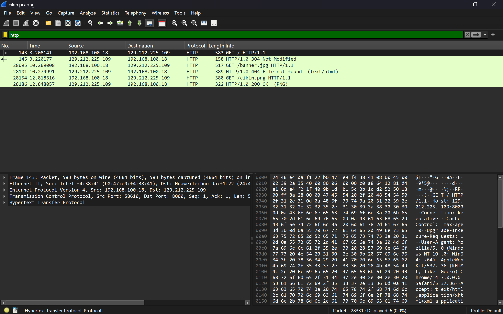
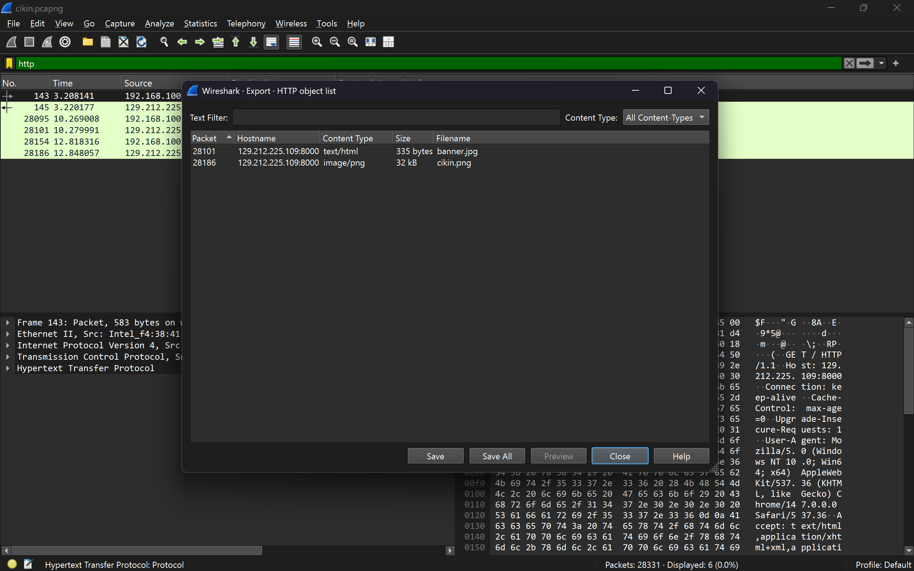
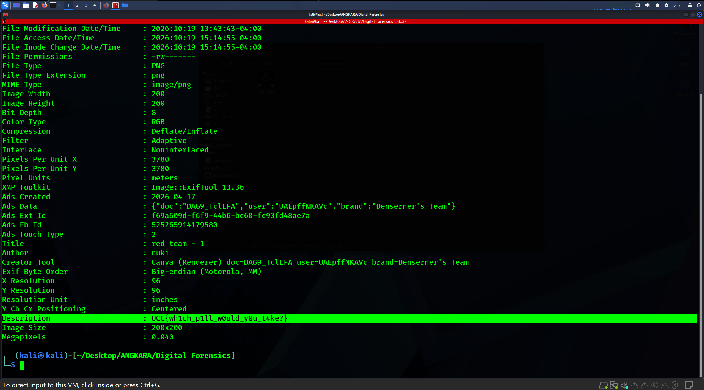

# Missing Cikin

- **Category:** Digital Forensics
- **Difficulty:** Easy

## Challenge Description

> An employee reported suspicious behavior after accessing an internal web portal.
>
> They insist they only downloaded a profile image but security monitoring flagged the activity as unusual.
>
> We managed to capture the network traffic during the session.
>
> Can you analyze the packet capture and determine if anything hidden was transferred?
>
> Author: @Aoba

## Analysis

### Step 1: Analyze the .pcapng file

The challenge provided a **.pcapng** file. I opened the file in Wireshark:



The challenge mentioned that the employee downloaded a profile image from an internet portal. I set the display filter to **http** to filter out all http protocol logs in the network traffic.



From here, i found out there are 2 GET requests that are sent to the web portal:

- banner.jpg
- cikin.png



I exported the file objects and begin investigating them

### Step 2: Investigate the files

I investigated **cikin.png** file first since the challenge name is Missing Cikin (lol).

I opened up kali linux and used exiftool command to view the metadata of the file:

```bash
exiftool cikin.png
```



From the output, we can see that the file's description metadata shows the flag for this challenge.

Therefore, the flag is:

```text
UCC{wh1ch_p1ll_w0uld_y0u_t4ke?}
```

---
