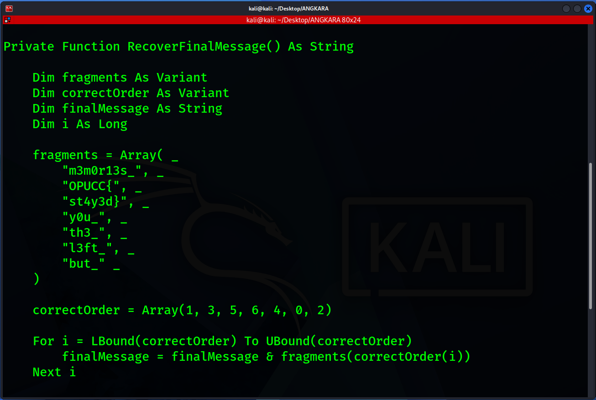

# The one that got away

- **Category:** Digital Forensics
- **Difficulty:** Easy

## Challenge Description

> I found this note online and got curious on what is the last message of this note. Can you find it out for me?
>
> Flag Format: OPUCC{flag}
>
> Author: 171k

## Analysis

### Step 1: Analyze the .docm file

Since the challenge provided a .docm file, i used olevba from oletools package to inspect the document:

```bash
olevba TheOneThatGotAway_1.docm
```

The tool extracted the VBA code stored inside the document. Theres one segment of code i found interesting which is this part:



This could probably lead to the challenge code!

### Step 2: Construct the flag

```vb
fragments = Array( _
    "m3m0r13s_", _
    "OPUCC{", _
    "st4y3d}", _
    "y0u_", _
    "th3_", _
    "l3ft_", _
    "but_" _
)

correctOrder = Array(1, 3, 5, 6, 4, 0, 2)
```

From this code, we can arrange the arrays by the correct order:

- 1 - OPUCC{
- 3 - y0u\_
- 5 - l3ft\_
- 6 - but\_
- 4 - th3\_
- 0 - m3m0r13s\_
- 2 - st4y3d}

Therefore, the final flag is:

```text
OPUCC{y0u_l3ft_but_th3_m3m0r13s_st4y3d}
```

---
