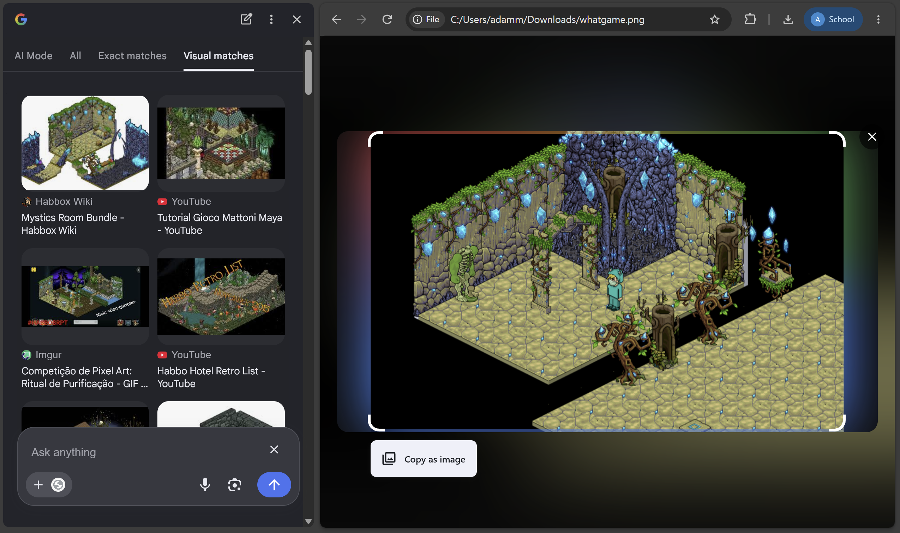
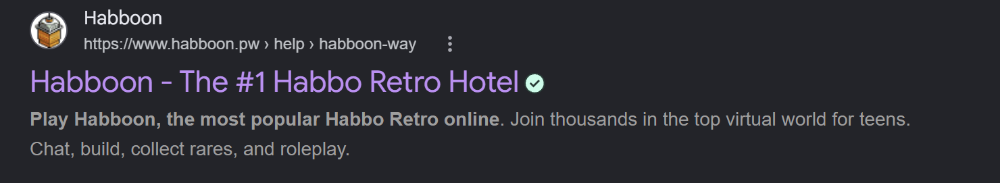

# My childhood game

- **Category:** OSINT
- **Difficulty:** Easy

## Challenge Description

> Back in 2014, I used to play this one game to socialize with people around the world but now I forgot the game name.. can you find out what game is it based on this screenshot?
>
> Oh, I also played an unofficial version of the game for unlimited currency hehe
>
> Flag Format: OPUCC{game_name}
>
> Author: 171k

## Analysis

### Step 1: Analyze the image

Firstly, i straight away scanned the image with Google Lens



Google Lens gave me some results of similar pictures and possible game names:

- Habbo
- Habbo hotel
- Habbox

I tried to submit all these as flags but none are correct.

Then i looked back at the challenge's description. it says that the game has an unofficial version of the game for unlimited currency(?)

### Step 2: Research

I opened up google and searched for "Habbo unofficial version". Many search results bumped up but this one came out on top of my search result:



Then, i tried to submit this as the flag and somehow its correct lol. Therefore the flag is:

```text
OPUCC{habboon}
```

---
