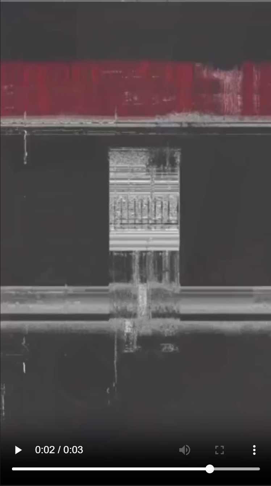
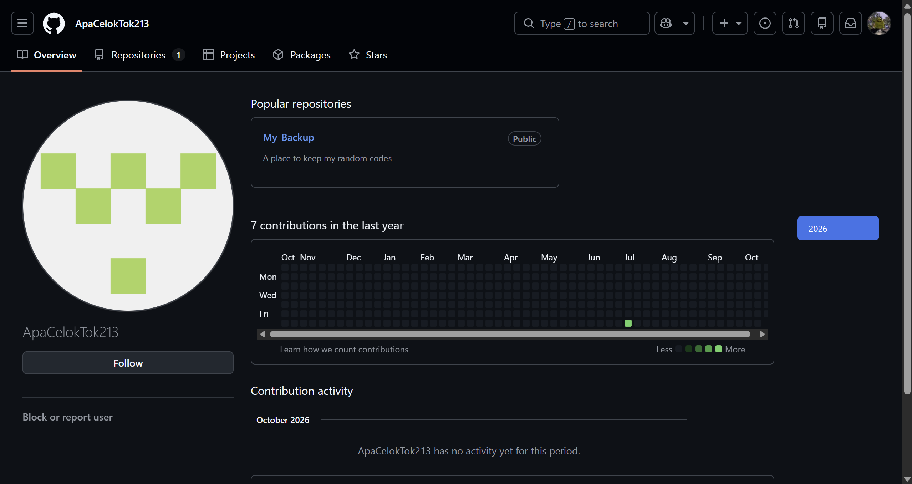
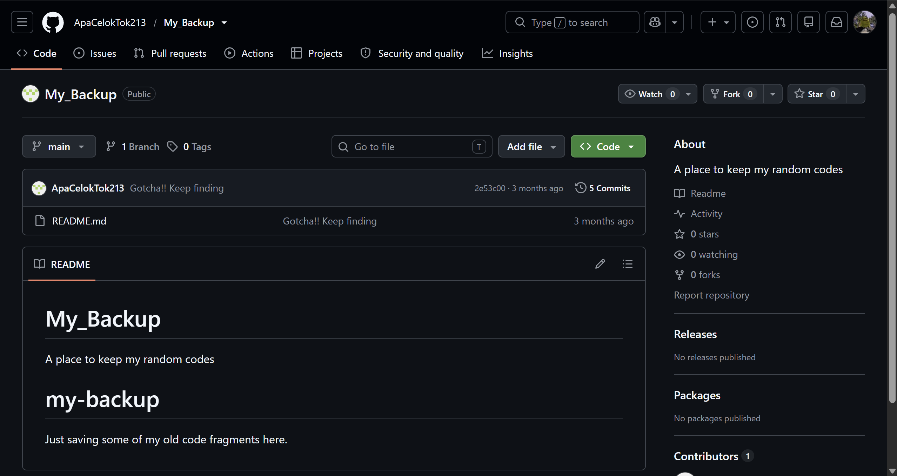
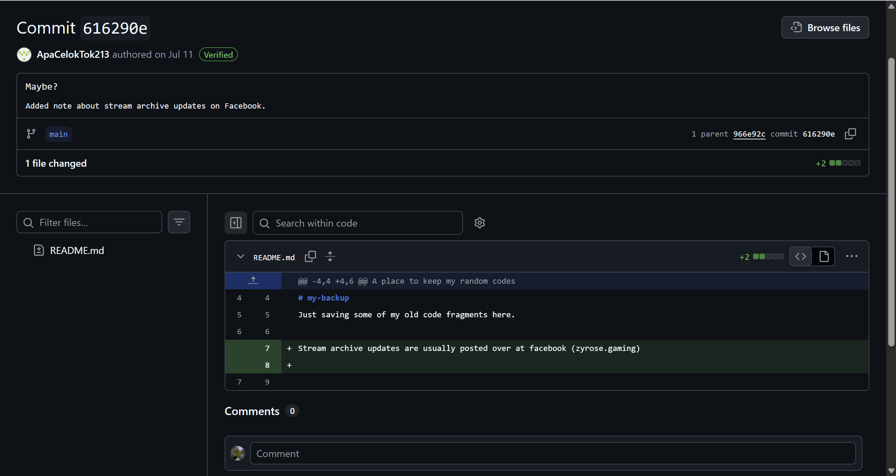
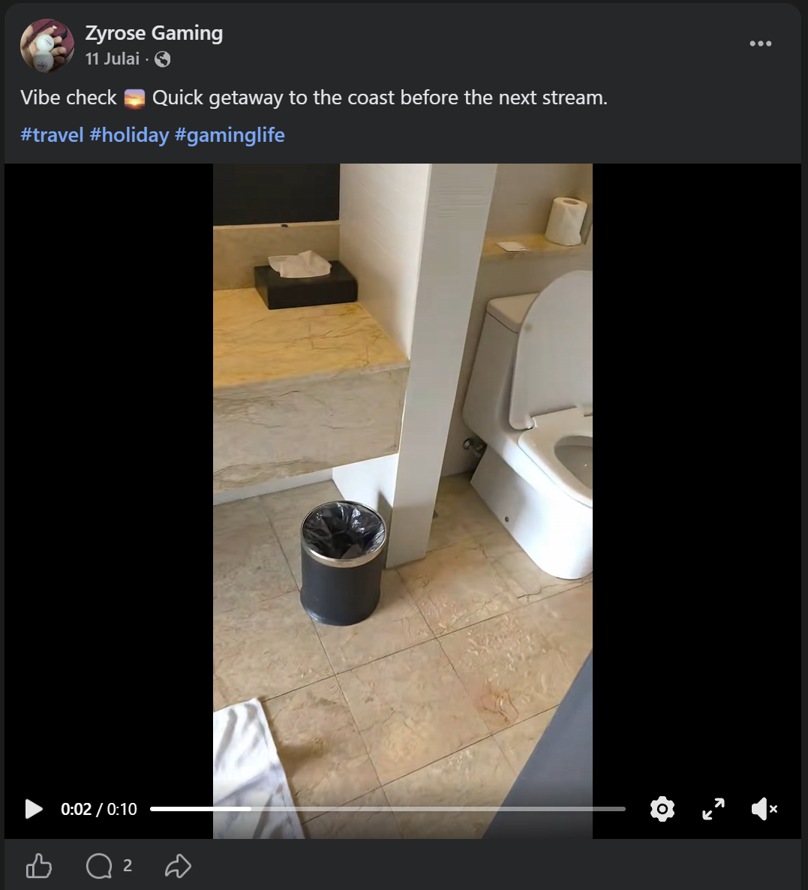
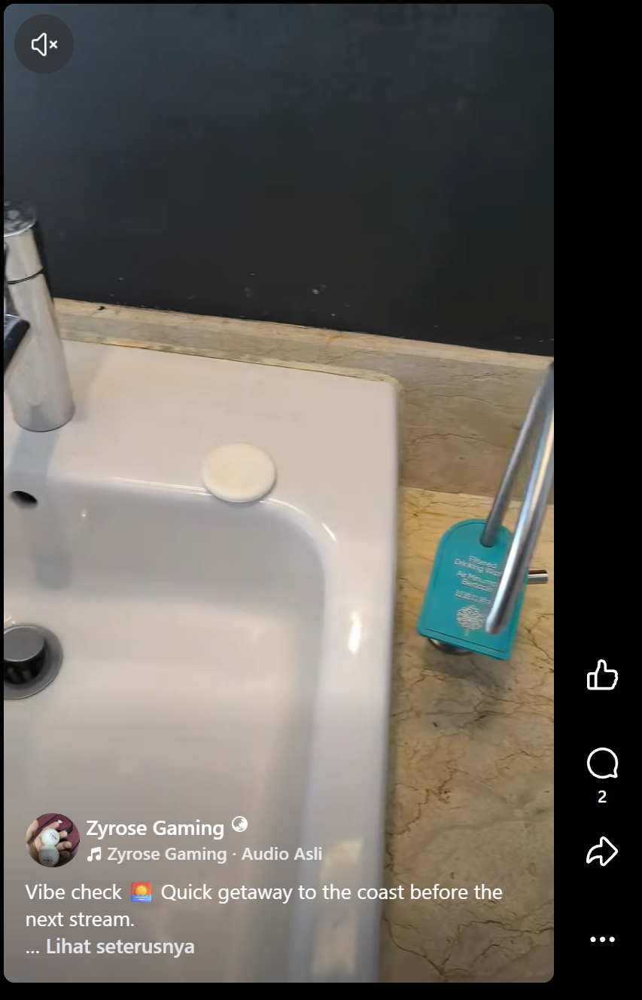
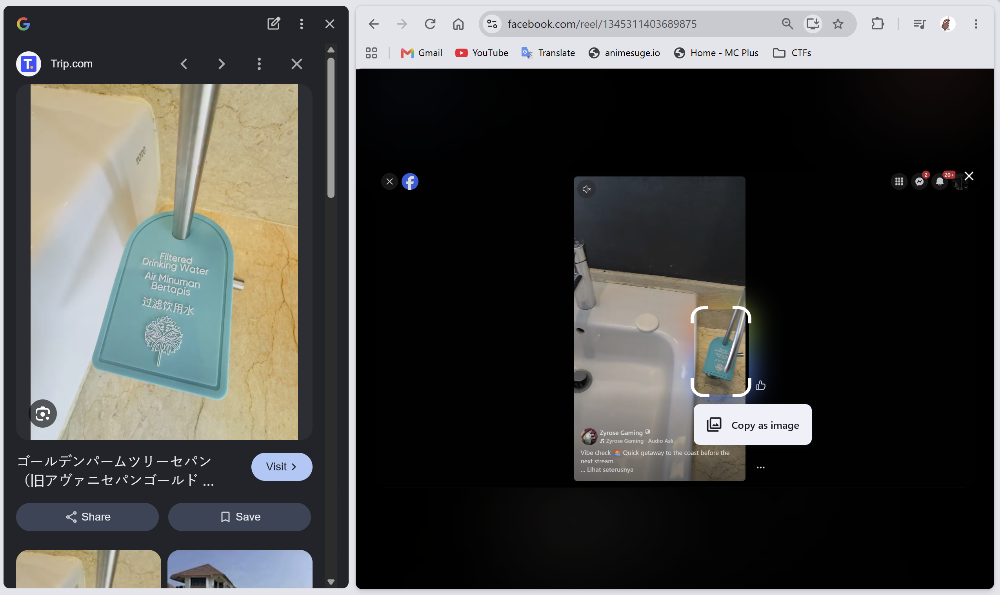
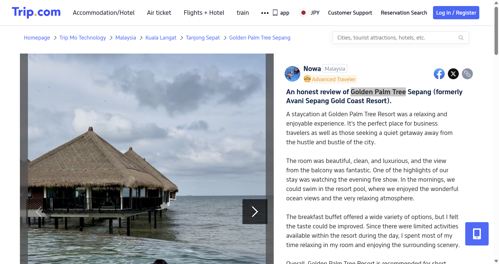

# Solliitt!!!!

- **Category:** OSINT
- **Difficulty:** Easy

## Challenge Description

> I was going through an old phone backup yesterday and found a weird, corrupted video clip.
>
> It is only about two seconds long and cuts off abruptly. I honestly do not even remember recording it, and the clip itself is too short to figure out where it was taken. The only useful thing I found was a reference to the GitHub username ApaCelokTok213 attached to the file.
>
> I'm pretty sure this is just a snippet of a longer video that was posted somewhere online.
>
> Can you help me find the location where the video is taken?
>
> Flag Format: OPUCC{Official_Place_Filmed}

## Analysis

### Step 1: Analyze the mp4 file

I played the mp4 video and it seems like the video has been corrupted and no clues found here.



### Step 2: Searched up username on GitHub

In the description, it mentioned that the only useful thing that he found was a reference to the GitHub username ApaCelokTok213 attached to the file. I searched up the username and found the user and it has a public repository.



I went into the repository and found a README.md file:



Went through the file but i found nothing. Then, i dive into the commits history and found this:



### Step 3: Searched up the username on Facebook

After the findings, i opened up Facebook to find the username **zyrose.gaming**. After searching the username, i found the post with the full video (that was corrupted) on the user's page!:
https://www.facebook.com/share/r/1LvHbpinBQ/



I looked carefully and analyzed the video, i found something useful in the video:



The label on the water tap seems to be a clue of where this video is taken. I tried using google lens to search for any similar images taken with this label.



The google lens search found an image similar to one on the video. I tried visit the website where the image belongs

### Step 4: Visited trip.com website

As soon as i opened the website, i found the location where the picture is from!



The actual location where the video is taken is at Golden Palm Tree. Therefore, the flag of this challenge is:

```text
OPUCC{Golden_Palm_Tree}
```

---
