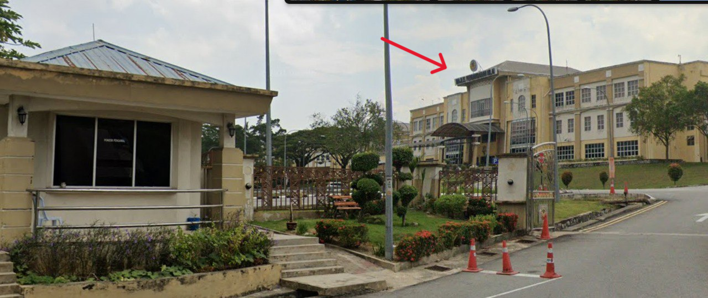
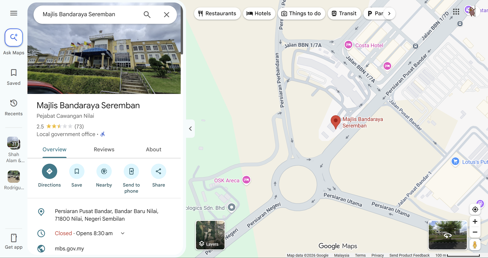
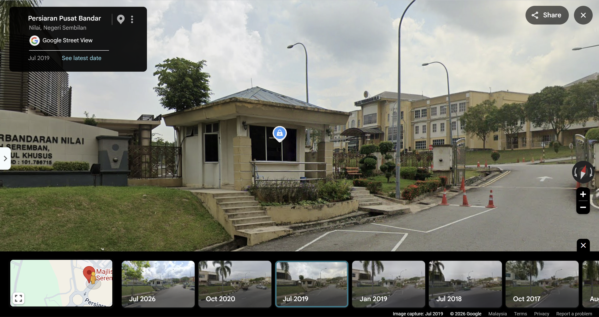
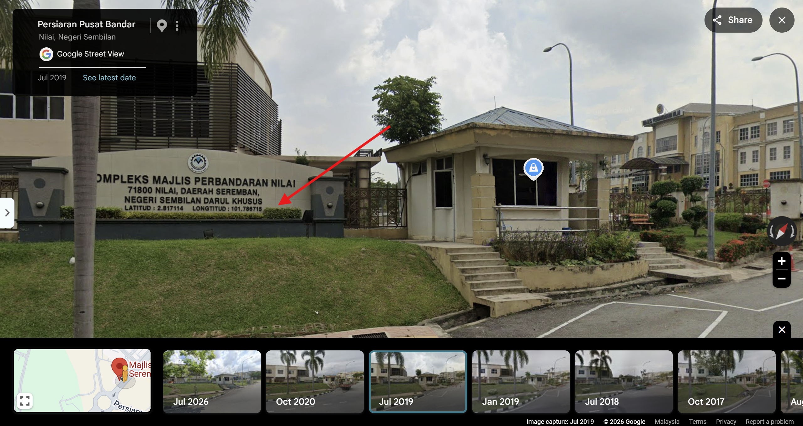

# Tax me if you can!

- **Category:** OSINT
- **Difficulty:** Hard

## Challenge Description

> Two years ago, I visited a local municipal office to settle my annual property assessment tax.
>
> It was a hot afternoon. I remember passing a small cream-colored guardhouse at the entrance, then parking within the compound before heading into the main administrative building.
>
> Recently, I needed to revisit the office, but I completely forgot its exact location.
>
> Interestingly, I later found out that the municipality had undergone a restructuring, and the office may no longer operate under its old name.
>
> All I have left is this photo of the entrance guardhouse.
>
> Can you help me find the exact location?
>
> Flag format: OPUCC{x.xxxxxx_xxx.xxxxxx}

## Analysis

### Step 1: Analyze the image

The image shows the local municipal office mentioned in the description.

After analyzing the image, i found the name of the municipal office, **Majlis Perbandaran Nilai** at the top of the building



### Step 2: Searched Majlis Perbandaran Nilai on Google Maps

I searched for Majlis Perbandaran Nilai on Google Maps and it automatically shows Majlis Bandaraya Seremban.



I opened street view and viewed previous dates of the area and i found out that this location is previously named **Majlis Perbandaran Nilai** and it matches the given image of this challenge.



After looking around the area, i found out the latitude and longitude of this location is stated on their monument sign:



Therefore, the flag of this challenge is:

```text
OPUCC{2.817114_101.786715}
```

---
