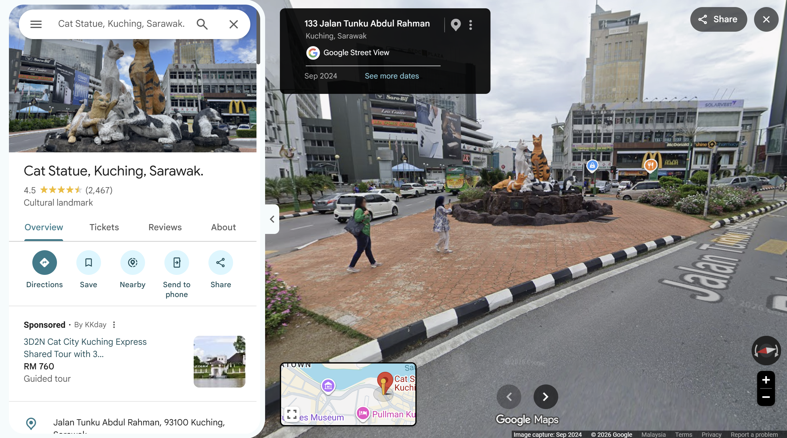
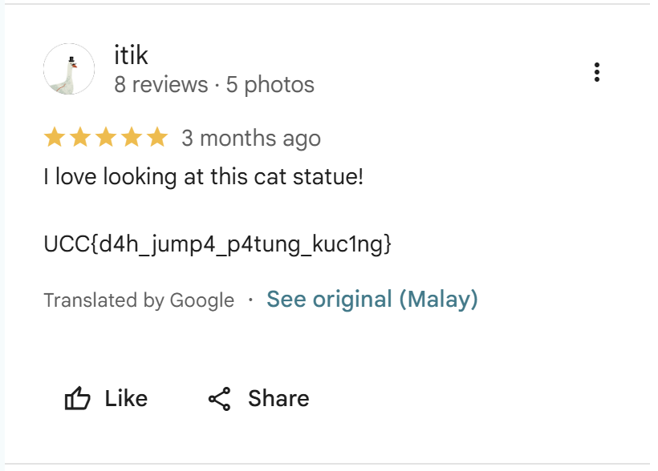

# mEoW

- **Category:** OSINT
- **Difficulty:** Easy

## Challenge Description

> Di Malaysia, terdapat sebuah patung kucing yang sangat terkenal dan sering dijadikan tarikan pelancong. Patung ini menyimpan rahsia yang hanya boleh ditemui oleh pengkaji OSINT yang berkemahiran tinggi. Untuk cabaran ini, peserta perlu mencari lokasi sebenar patung kucing tersebut. Flag untuk soalan ini tersembunyi di lokasi patung tersebut. Format flag yang diperlukan adalah
>
> Flag Format: UCC{...........FUN}.

## Analysis

### Step 1: Searched up the location on google

The first thing i did was searching on google for "patung kucing terkenal di Malaysia". The search result shows the famous patung kucing is located at Kuching, Sarawak.


So, i searched up on google maps to see whats hidden there.

### Step 2: Searched for clues at the location on Google Maps

Firstly i did after searching the cat statue on google maps is i scouted the location on street view. I looked all over the place including signboards, billboards and also banners around the location then i found nothing.



Then, i decided to scroll at the Reviews section and found this:



Then i tried to submit the flag and it works! Therefore, the flag is:

```text
UCC{d4h_jump4_p4tung_kuc1ng}
```

(the flag format is basically a scam -,-)

---
