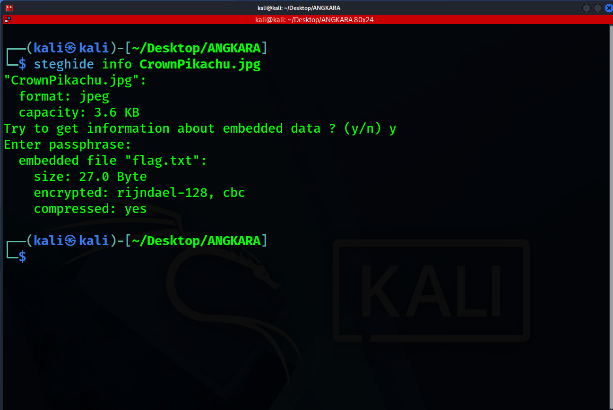
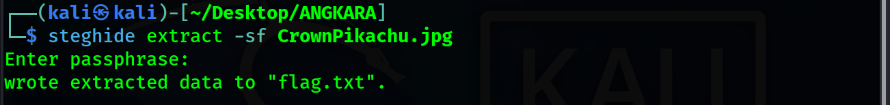
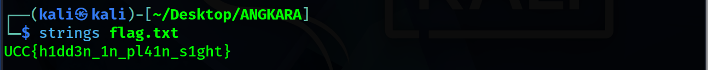

# PikachuEx

- **Category:** Steganography
- **Difficulty:** Easy

## Challenge Description

> Last week, I pulled the Crown Pikachu EX. I was so happy! To make sure it stays safe from any of my friends, I hid something inside the card so that I'll know it's mine if it ever goes missing.
>
> Flag Format : UCC{some_random_text}

## Analysis

### Step 1: Analyze the file

First, i ran

```bash
steghide info CrownPikachu.jpg
```



The output shows that there is an embedded file inside the CrownPikachu.jpg

### Step 2: Extract the file

Next, i extracted flag.txt by running:

```bash
steghide extract -sf CrownPikachu.jpg
```

since there is no passphrase, the embedded data is directly extracted out to a file named "flag.txt".



Next, i ran:

```bash
strings flag.txt
```

Then the output came out:



Therefore, the flag is:

```text
UCC{h1dd3n_1n_pl41n_s1ght}
```

---
