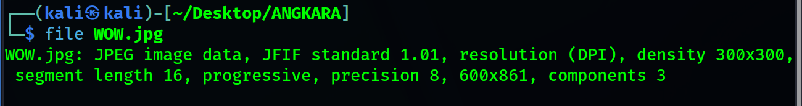
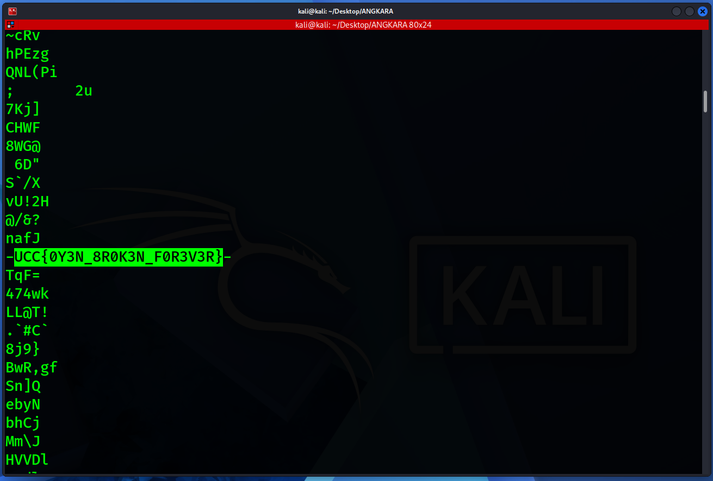

# WOWERRZZZZ

- **Category:** Steganography
- **Difficulty:** Easy

## Challenge Description

> A cat named Oyen often gazes out the window while sitting at the edge of the bed, looking at an old portrait. Oyen's heart is broken, yet he still can't move on. Oyen keeps remembering one thing she once said. Can you find those words?

## Analysis

### Step 1: Analyze the file

First, i ran

```bash
file WOW.jpg
```



It seems like its a normal JPEG file image

Then i ran:

```bash
strings WOW.jpg
```

It outputs a long string. After a little bit of scrolling, i found:



I tried submitting this flag and it worked! Therefore, the flag is:

```text
UCC{0Y3N_8R0K3N_F0R3V3R}
```

---
